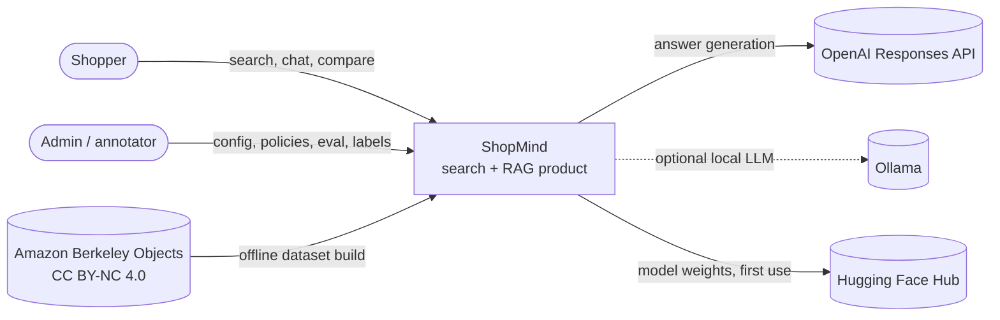
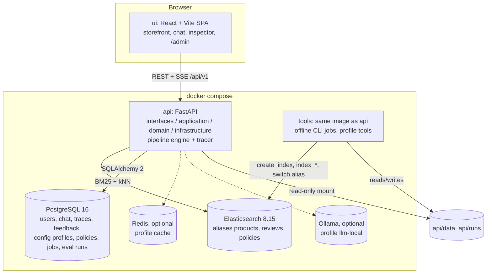

# ShopMind architecture

This document describes the target architecture from [`REFACTOR_PLAN.md`](REFACTOR_PLAN.md) §3
using the C4 model (levels 1 and 2), plus the rules that keep the codebase consistent.
Decisions behind it are recorded in [`adr/`](adr/).

## Level 1: system context



| Actor / system | Role |
|---|---|
| Shopper | Uses the public storefront: text/image/compose search, product pages, chat assistant. No login. |
| Admin / annotator | Uses `/admin` with a JWT: dashboard, config, traces, indexes, policy CMS, evaluation, relevance labels. |
| OpenAI | LLM for RAG answers, query rewrite and query understanding. Optional: search works without it. |
| Ollama | Optional local LLM provider (compose profile `llm-local`). |
| Hugging Face Hub | Source of SigLIP2, E5 and cross-encoder weights (cached in the image/volume). |
| ABO | Source dataset; a 1,500-product subset is downloaded and built offline. |

## Level 2: containers



| Container | Technology | Responsibility |
|---|---|---|
| `frontend` | React + Vite (Feature-Sliced Design) | Single SPA; admin is a lazy-loaded `/admin` route branch. Talks only to `/api/v1`. |
| `api` | FastAPI, Python 3.12 image | All business logic behind REST + SSE. Runs `alembic upgrade head` on start (`docker-entrypoint.sh`). |
| `elasticsearch` | ES 8.15.3, single node | Search read model. Physical indexes are versioned; the app reads only aliases. |
| `postgres` | PostgreSQL 16 | System of record for everything that is not a search document ([ADR 0002](adr/0002-postgresql-system-of-record.md)). |
| `tools` | Same image as `api`, `./api` mounted read-write | Embedding generation, indexing, evaluation; anything that loads a model runs here on CPU. |
| `redis`, `ollama` | Optional | Cache and local LLM, enabled by compose profiles. |

## Backend layers and dependency rule

```text
interfaces  ──►  application  ──►  domain  ◄──  infrastructure
(HTTP, CLI)      (use cases)       (models,      (Elasticsearch, PostgreSQL,
                                    ports)        SigLIP2/E5, OpenAI, rerankers)
                         ▲
                     bootstrap (settings + container: the only place that wires adapters to ports)
```

Rules ([ADR 0004](adr/0004-clean-architecture-layout.md)):

1. `domain/` is pure Python: no FastAPI, Elasticsearch, SQLAlchemy, torch or OpenAI imports.
   It holds models (`Product`, `SearchQuery`, `Candidate`, `KnowledgeDocument`, `Citation`, `Trace`),
   ports (`Protocol`s such as `Embedder`, `Retriever`, `Reranker`, `LLM`, `TraceStore`) and domain errors.
2. `application/` contains one use case per module (search, rag, admin, feedback) and depends only on
   `domain` ports.
3. `infrastructure/` implements ports (adapters). It may import `domain`, never `application` or
   `interfaces`.
4. `interfaces/` (HTTP routers, schemas, SSE, auth, the exception → `(status, code)` table, CLI)
   calls use cases; it does not talk to Elasticsearch or the database directly.
5. `bootstrap/` (`settings.py`, `container.py`, `app.py`) is the composition root.
6. `ingestion/` is the offline pipeline (prepare → embed → index), separate from the runtime
   pipeline engine.

CI enforces part of this mechanically: `scripts/ci/check_hardcode.sh` fails if `domain/`,
`application/` or `interfaces/` contain physical index names or model ids.

## Configuration layering

Lowest to highest precedence ([ADR 0003](adr/0003-config-driven-pipeline-engine.md)):

```text
configs/base.yaml
  └─► configs/profiles/<SHOPMIND_PROFILE>.yaml      (dev | demo | eval)
        └─► environment variables                  SHOPMIND__RAG__LLM__MODEL=...  (pydantic-settings, "__" delimiter)
              └─► runtime overrides                 saved from /admin in PostgreSQL (hot-reloadable keys only)
```

- Every config model keeps `extra="forbid"`: an unknown key in YAML, env or an admin override is an error.
- Runtime overrides are validated with the same Pydantic models before they are applied, and every
  saved profile can be rolled back.
- Secrets (`OPENAI_API_KEY`, `JWT_SECRET`, database password) come only from the environment
  ([`.env.example`](../.env.example)), never from YAML or the database.
- Evaluation overlays (`configs/experiments/*.yaml`, `configs/experiments/rag/*.yaml`) are merged on top
  of the same model, so runtime and evaluation share one engine.

## Pipeline registry and engine

Components register themselves by kind and name; pipelines are declared in YAML and executed by one
engine that records a trace for every step.

```python
@register("retriever", "bm25")
class BM25Retriever: ...

@register("fuser", "rrf")
def rrf(rankings, k: int = 60, weights: list[float] | None = None): ...
```

```yaml
pipelines:
  search.hybrid:
    steps:
      - { step: query_understanding, impl: rules }
      - { step: retrieve, id: lexical,  impl: bm25,  params: { candidate_k: 100 } }
      - { step: retrieve, id: semantic, impl: dense, params: { field: text_vector, embedder: text_e5 } }
      - { step: fuse, impl: rrf, params: { k: 60 } }
      - { step: rerank, impl: noop }
```

| Kind | Implementations (target) |
|---|---|
| `embedder` | `siglip2` (image + cross-modal), `sentence_transformer` (E5/BGE text, [ADR 0001](adr/0001-text-embedder-e5.md)) |
| `retriever` | `bm25`, `dense` (any vector field), multi-source for RAG |
| `fuser` | `rrf` (weighted), `linear` (min-max), `concat` |
| `reranker` | `noop`, `cross_encoder`, `attribute_boost` |
| `llm` | `openai`, `ollama` |
| steps | `query_understanding`, `rewrite`, `retrieve`, `multi_source_retrieve`, `fuse`, `rerank`, `compose_query`, `build_context`, `generate`, `validate_citations`, `route_intent` |

Each step emits a `StepTrace` (id, impl, params, timing, capped output items, notes). Traces never
contain image bytes or embedding vectors, only dimensions/norms. The trace schema is defined in
[`API_CONTRACT.md`](API_CONTRACT.md#trace-schema).

## Offline pipeline and index versioning

```text
scripts.prepare_a1_abo_subset → data/a1_abo_1500/products.jsonl
scripts.generate_embeddings   → data/embeddings/<version>/ (product_ids.json, *_embeddings.npy, manifest.json)
scripts.create_index          → products_a1_1500_vN (versioned physical index)
scripts.index_products        → validate doc count, dims, BM25 + kNN smoke search → switch alias `products`
```

Re-indexing never re-runs the embedding model. A3 mirrors the flow for `reviews` and `policies`.
The application only ever reads the aliases `products`, `reviews`, `policies`.

## Cross-cutting concerns

- **Errors:** one exception → `(HTTP status, code)` table; body `{"error": {"code", "message"}, "request_id"}`.
- **Health:** `/health` is liveness only; `/ready` reports each component. Init failures are stored, not
  raised, so `/health` stays up while `/ready` returns 503.
- **Auth:** JWT for `/api/v1/admin/*`, `/api/v1/debug/*`, `/api/v1/traces/*`; storefront is public.
- **Privacy:** image bytes and vectors are never logged; public search results expose only
  `product_id, title, image_url, brand, category, score, rank`.
